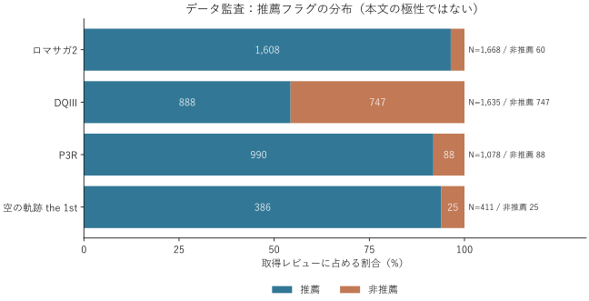
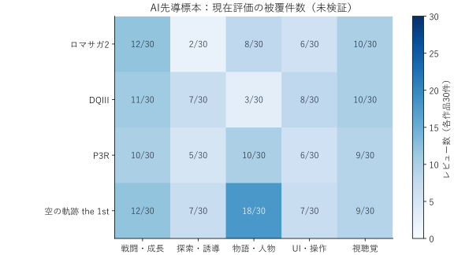

# JRPGリメイク作品におけるゲーム要素別の評価

Steam日本語レビューを対象に、要素別の現在評価と、明示的な旧版比較の関係・方向を区別する修士論文研究です。文書は日本語で整理しています。

**状態：先導調査版の初稿。人手検証・全量の意味抽出は未実施。** AIの再判定を独立人手検証とは呼びません。

## 読む順序

1. [論文初稿](manuscript/thesis_with_references_ja.md)
2. [研究計画](protocol/research_plan_ja.md)・[判断の記録](docs/decision_log_ja.md)
3. [文献20編の照合台帳（日本語6編）](literature/references_ja.md)
4. [データ監査](results/data_audit.json)・[先導集計](results/pilot_report_ja.md)
5. [コードブック](protocol/codebook_ja.md)・[独立人手検証](protocol/human_validation_ja.md)
6. [データ辞書](docs/data_dictionary_ja.md)・[再現手順](docs/reproduction_ja.md)

## 正式ケース

|作品|AppID|取得件数|非推薦|
|---|---:|---:|---:|
|ロマンシング サガ2 リベンジオブザセブン|2455640|1668|60|
|ドラゴンクエストIII HD-2D Remake|2701660|1635|747|
|ペルソナ3 リロード|2161700|1078|88|
|空の軌跡 the 1st|3375780|411|25|
|合計||4792|920|

投稿時刻の締切：2026-10-26 23:59:59 JST。本文等は2026-10-27取得時点の状態。公式APIを最後の空ページまで取得し、ID重複なし・該当件数との一致を確認しました。

SO2R、FFVII REBIRTHは正式分析に含めません。『空の軌跡』の別AppIDも合算しません。1000件条件は後続のユーザー指定によって緩和しました。

## 現段階で分かること

正式4作品各30件、計120件のAI先導注釈を作成しました。具体要素の現在評価は74件、明示的な要素別旧版比較は22件に暫定的に認められました。保持を褒める表現を、改善と同一視しない規則が必要でした。これは未検証の小標本であり、4792件全体の意味分析結果ではありません。

## 公開・非公開の範囲

公開するものは集計、未検証ラベル、ID、分類規則、抽出仕様、分析コード、取得記録です。レビュー全文・投稿者識別情報・論文PDFはローカルに保存し、公開しません。参考文献は20編を登録し、うち16編について公開全文PDFまたは著者稿をローカル取得しました。取得と精読は区別し、本文未確認箇所は台帳に明記しています。

先導とは非重複の200件を人手検証用に確保しました。最終稿への更新は、独立人手検証と必要な再抽出・再分析の後に行います。元の核心10編の一覧と学校の形式指定は未提供です。
